<div align="center">



[](https://github.com/CodeByHaamza/Persona_GRUB_Themes/stargazers)
[](#-the-gallery)
[](#-the-gallery)
[](https://www.gnu.org/software/grub/)
[](LICENSE)
<!-- hd-progress -->[](#-the-gallery)<!-- /hd-progress -->

### Turn your boot menu into a Persona menu.

**68 GRUB themes** made from the **official All-Out Attack** artwork of<br>
*Persona 5 Royal* · *Persona 5: The Phantom X* · *Persona 3 Reload* · <sub>*Persona 4 Revival coming soon*</sub>

<br>

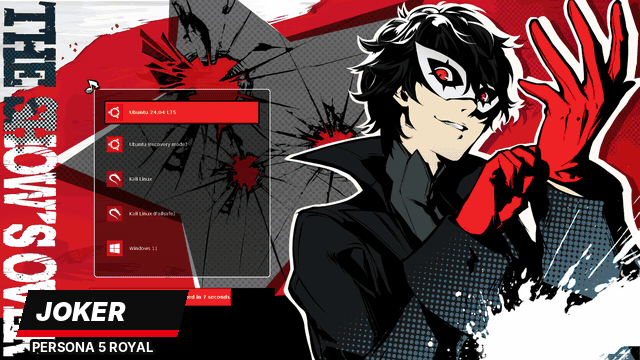

<br>

[**⚡ Quick start**](#-quick-start) &nbsp;·&nbsp;
[**🃏 Gallery**](#-the-gallery) &nbsp;·&nbsp;
[**🔧 Installation**](#-installation) &nbsp;·&nbsp;
[**🌙 Troubleshooting**](#-troubleshooting) &nbsp;·&nbsp;
[**🧭 Roadmap**](ROADMAP.md) &nbsp;·&nbsp;
[**🤝 Contributing**](#-contributing)

</div>


## ⚡ Quick start

```bash
git clone https://github.com/CodeByHaamza/Persona_GRUB_Themes.git
cd Persona_GRUB_Themes
sudo python3 install.py
```

Pick a game, pick a character, reboot. Your original GRUB config is saved, and `sudo python3 install.py --restore` puts it back at any time.

## ✨ Features

<table>
<tr>
<td width="50%" valign="top">

🃏 **Official All-Out Attack art** for every character<br>
🎨 **A colour scheme per character**, tuned for readability<br>
🔄 **Outfit variants**: Summer, Chinese New Year, Valentine...<br>
🎮 **3 games**: P5R (13), P5X (42), P3R (13)

</td>
<td width="50%" valign="top">

🔧 **Interactive installer**, or one command: `--theme joker`<br>
🐧 **Ubuntu, Debian, Arch, Fedora, openSUSE** and more<br>
↩️ **Safe**: original config kept, `--restore` / `--uninstall`<br>
🖥️ **Resolution detected** automatically<br>
🦋 **Velvet Room** entry and 💿 **Ventoy** support

</td>
</tr>
</table>


## 🃏 The Gallery

<sub>Click a theme to see the full-size preview. ✅ HD: official art in full resolution · ⏳ HD soon: being re-extracted from the games for v2.</sub>


<!-- gallery:persona5_royal -->
<div align="center">

<table>
<tr><td align="center"><a href="previews/persona5_royal/joker.png">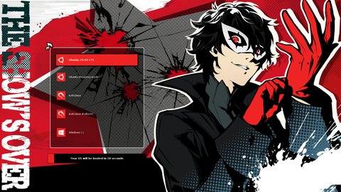</a><br><b>Joker</b><br><sub>✅ HD</sub></td><td align="center"><a href="previews/persona5_royal/skull.png">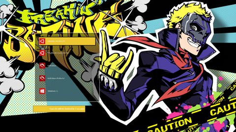</a><br><b>Skull</b><br><sub>✅ HD</sub></td><td align="center"><a href="previews/persona5_royal/panther.png">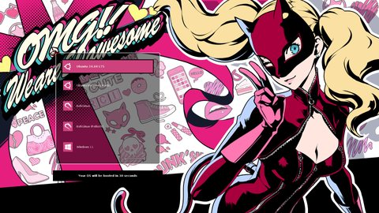</a><br><b>Panther</b><br><sub>✅ HD</sub></td></tr>
<tr><td align="center"><a href="previews/persona5_royal/morgana.png">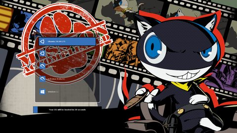</a><br><b>Morgana</b><br><sub>✅ HD</sub></td><td align="center"><a href="previews/persona5_royal/fox.png">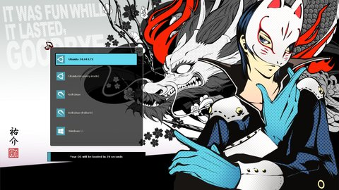</a><br><b>Fox</b><br><sub>✅ HD</sub></td><td align="center"><a href="previews/persona5_royal/queen.png">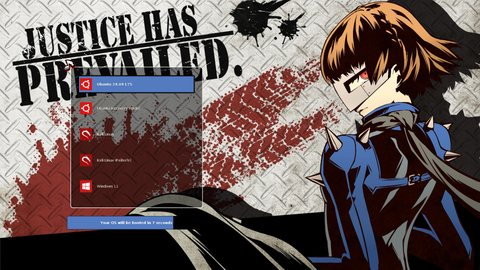</a><br><b>Queen</b><br><sub>✅ HD</sub></td></tr>
</table>

<details>
<summary><b>Show 7 more Persona 5 Royal themes</b></summary>
<br>

<table>
<tr><td align="center"><a href="previews/persona5_royal/oracle.png">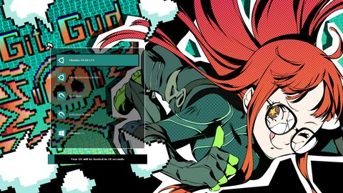</a><br><b>Oracle</b><br><sub>✅ HD</sub></td><td align="center"><a href="previews/persona5_royal/noir.png">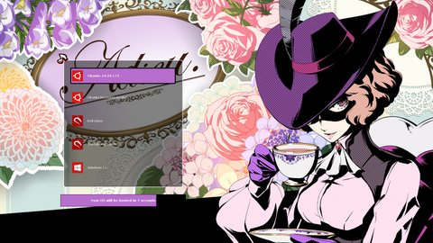</a><br><b>Noir</b><br><sub>✅ HD</sub></td><td align="center"><a href="previews/persona5_royal/crow.png">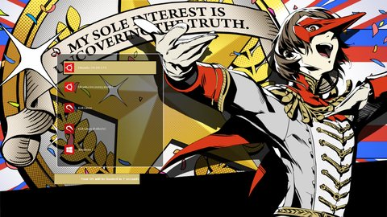</a><br><b>Crow</b><br><sub>✅ HD</sub></td></tr>
<tr><td align="center"><a href="previews/persona5_royal/violet.png">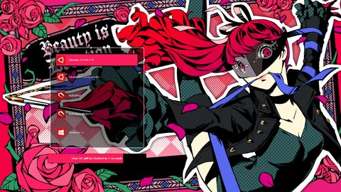</a><br><b>Violet</b><br><sub>✅ HD</sub></td><td align="center"><a href="previews/persona5_royal/black_mask.png">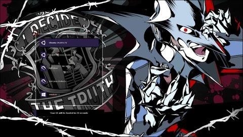</a><br><b>Black Mask</b><br><sub>⏳ HD soon</sub></td><td align="center"><a href="previews/persona5_royal/caroline_justine.png">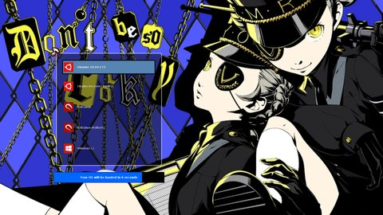</a><br><b>Caroline & Justine</b><br><sub>⏳ HD soon</sub></td></tr>
<tr><td align="center"><a href="previews/persona5_royal/lavenza.png">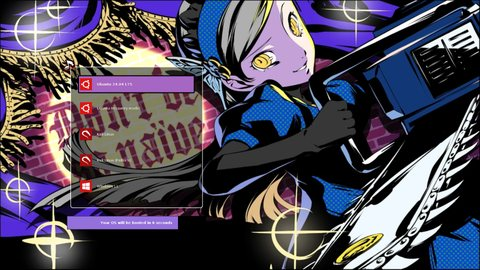</a><br><b>Lavenza</b><br><sub>⏳ HD soon</sub></td></tr>
</table>

</details>

</div>
<!-- /gallery:persona5_royal -->


<!-- gallery:persona5_phantom_x -->
<div align="center">

<table>
<tr><td align="center"><a href="previews/persona5_phantom_x/wonder.png">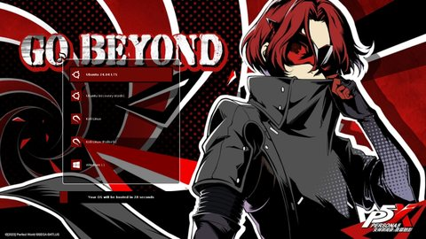</a><br><b>Wonder</b><br><sub>⏳ HD soon</sub></td><td align="center"><a href="previews/persona5_phantom_x/wonder_valentine.png">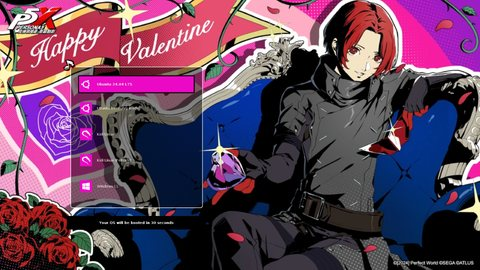</a><br><b>Wonder (Valentine)</b><br><sub>⏳ HD soon</sub></td><td align="center"><a href="previews/persona5_phantom_x/wonder_summer.png">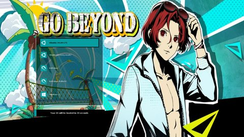</a><br><b>Wonder (Summer)</b><br><sub>⏳ HD soon</sub></td></tr>
<tr><td align="center"><a href="previews/persona5_phantom_x/wonder_cny.png">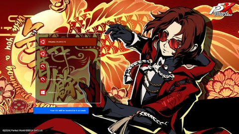</a><br><b>Wonder (Chinese New Year)</b><br><sub>⏳ HD soon</sub></td><td align="center"><a href="previews/persona5_phantom_x/ange.png">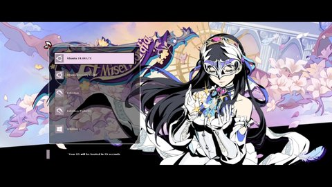</a><br><b>Ange</b><br><sub>⏳ HD soon</sub></td><td align="center"><a href="previews/persona5_phantom_x/berry.png">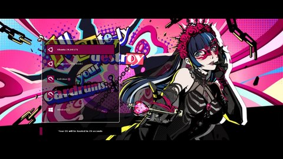</a><br><b>Berry</b><br><sub>⏳ HD soon</sub></td></tr>
</table>

<details>
<summary><b>Show 36 more Persona 5: The Phantom X themes</b></summary>
<br>

<table>
<tr><td align="center"><a href="previews/persona5_phantom_x/bui.png">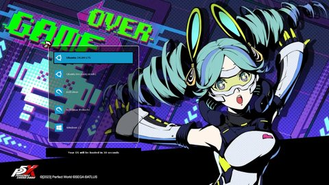</a><br><b>Bui</b><br><sub>⏳ HD soon</sub></td><td align="center"><a href="previews/persona5_phantom_x/bui_cosmic.png">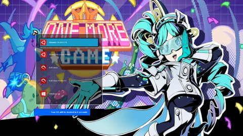</a><br><b>Bui (Cosmic)</b><br><sub>⏳ HD soon</sub></td><td align="center"><a href="previews/persona5_phantom_x/cattle.png">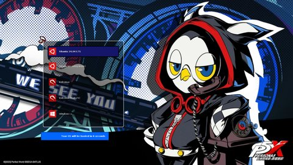</a><br><b>Cattle</b><br><sub>⏳ HD soon</sub></td></tr>
<tr><td align="center"><a href="previews/persona5_phantom_x/cherish.png">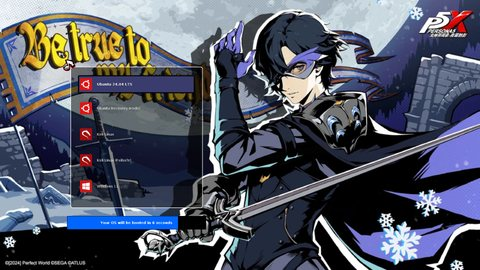</a><br><b>Cherish</b><br><sub>⏳ HD soon</sub></td><td align="center"><a href="previews/persona5_phantom_x/chord.png">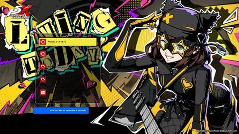</a><br><b>Chord</b><br><sub>⏳ HD soon</sub></td><td align="center"><a href="previews/persona5_phantom_x/closer.png">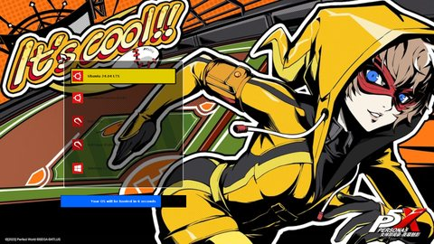</a><br><b>Closer</b><br><sub>⏳ HD soon</sub></td></tr>
<tr><td align="center"><a href="previews/persona5_phantom_x/closer_summer.png">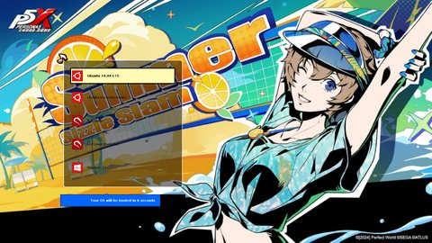</a><br><b>Closer (Summer)</b><br><sub>⏳ HD soon</sub></td><td align="center"><a href="previews/persona5_phantom_x/fleuret.png">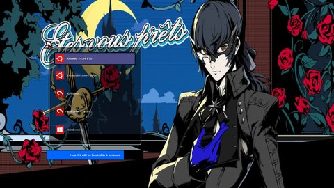</a><br><b>Fleuret</b><br><sub>⏳ HD soon</sub></td><td align="center"><a href="previews/persona5_phantom_x/howler.png">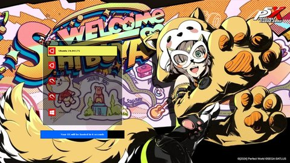</a><br><b>Howler</b><br><sub>⏳ HD soon</sub></td></tr>
<tr><td align="center"><a href="previews/persona5_phantom_x/key.png">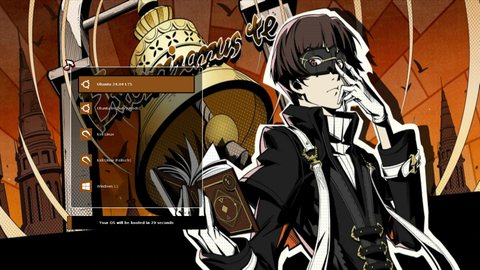</a><br><b>Key</b><br><sub>⏳ HD soon</sub></td><td align="center"><a href="previews/persona5_phantom_x/leon.png">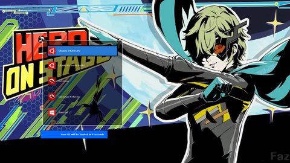</a><br><b>Leon</b><br><sub>⏳ HD soon</sub></td><td align="center"><a href="previews/persona5_phantom_x/luce.png">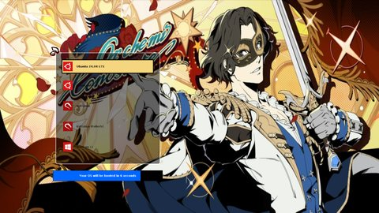</a><br><b>Luce</b><br><sub>⏳ HD soon</sub></td></tr>
<tr><td align="center"><a href="previews/persona5_phantom_x/luce_notte.png">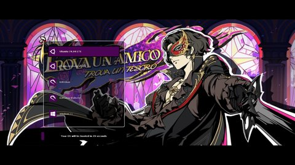</a><br><b>Luce (Notte)</b><br><sub>⏳ HD soon</sub></td><td align="center"><a href="previews/persona5_phantom_x/marian.png">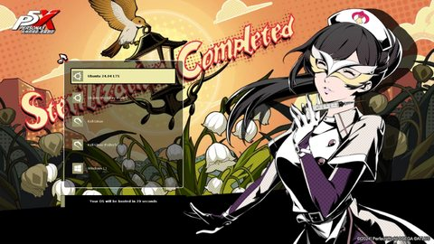</a><br><b>Marian</b><br><sub>⏳ HD soon</sub></td><td align="center"><a href="previews/persona5_phantom_x/marian_summer.png">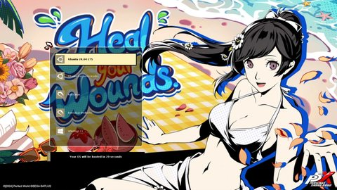</a><br><b>Marian (Summer)</b><br><sub>⏳ HD soon</sub></td></tr>
<tr><td align="center"><a href="previews/persona5_phantom_x/matoi.png">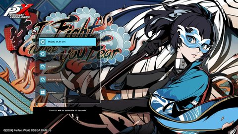</a><br><b>Matoi</b><br><sub>⏳ HD soon</sub></td><td align="center"><a href="previews/persona5_phantom_x/messa.png">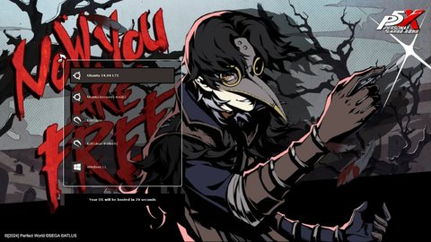</a><br><b>Messa</b><br><sub>⏳ HD soon</sub></td><td align="center"><a href="previews/persona5_phantom_x/moko.png">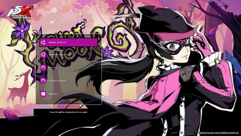</a><br><b>Moko</b><br><sub>⏳ HD soon</sub></td></tr>
<tr><td align="center"><a href="previews/persona5_phantom_x/moko_summer.png">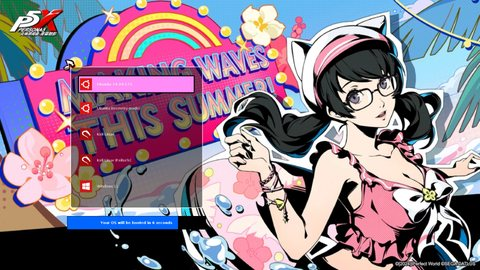</a><br><b>Moko (Summer)</b><br><sub>⏳ HD soon</sub></td><td align="center"><a href="previews/persona5_phantom_x/mont.png">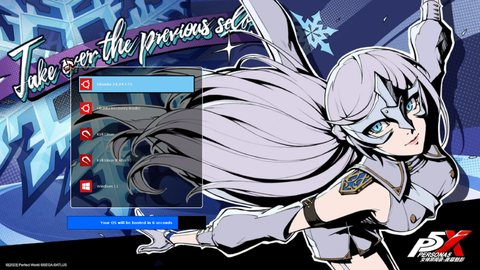</a><br><b>Mont</b><br><sub>⏳ HD soon</sub></td><td align="center"><a href="previews/persona5_phantom_x/mont_music.png">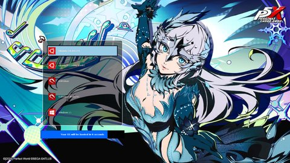</a><br><b>Mont (Music)</b><br><sub>⏳ HD soon</sub></td></tr>
<tr><td align="center"><a href="previews/persona5_phantom_x/okyann.png">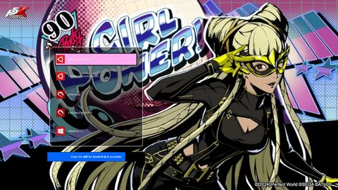</a><br><b>Okyann</b><br><sub>⏳ HD soon</sub></td><td align="center"><a href="previews/persona5_phantom_x/phoebe.png">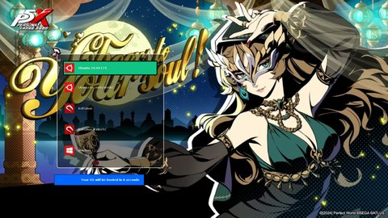</a><br><b>Phoebe</b><br><sub>⏳ HD soon</sub></td><td align="center"><a href="previews/persona5_phantom_x/puppet.png">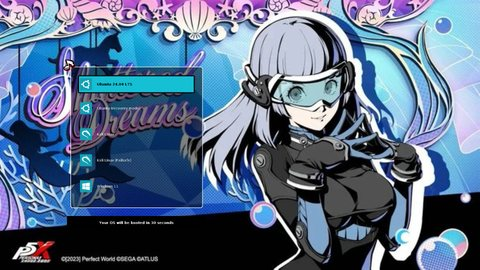</a><br><b>Puppet</b><br><sub>⏳ HD soon</sub></td></tr>
<tr><td align="center"><a href="previews/persona5_phantom_x/puppet_summer.png">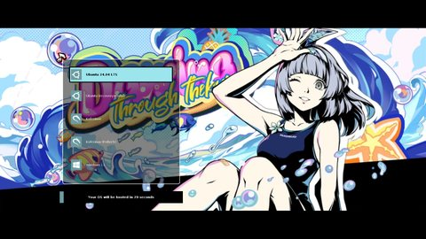</a><br><b>Puppet (Summer)</b><br><sub>⏳ HD soon</sub></td><td align="center"><a href="previews/persona5_phantom_x/riddle.png">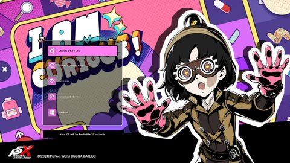</a><br><b>Riddle</b><br><sub>⏳ HD soon</sub></td><td align="center"><a href="previews/persona5_phantom_x/rin.png">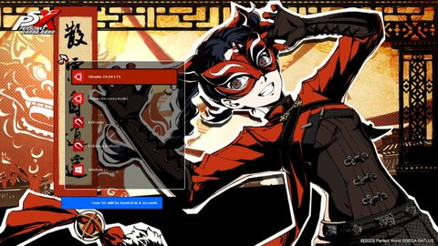</a><br><b>Rin</b><br><sub>⏳ HD soon</sub></td></tr>
<tr><td align="center"><a href="previews/persona5_phantom_x/rin_cny.png">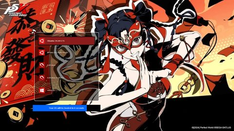</a><br><b>Rin (Chinese New Year)</b><br><sub>⏳ HD soon</sub></td><td align="center"><a href="previews/persona5_phantom_x/sepia.png">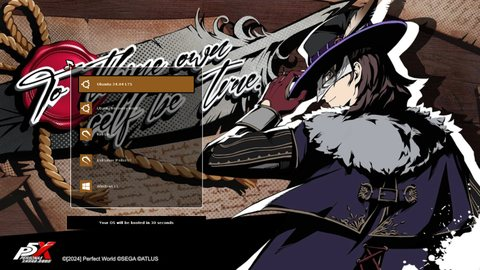</a><br><b>Sepia</b><br><sub>⏳ HD soon</sub></td><td align="center"><a href="previews/persona5_phantom_x/soy.png"></a><br><b>Soy</b><br><sub>⏳ HD soon</sub></td></tr>
<tr><td align="center"><a href="previews/persona5_phantom_x/soy_pioneer.png"></a><br><b>Soy (Pioneer)</b><br><sub>⏳ HD soon</sub></td><td align="center"><a href="previews/persona5_phantom_x/turbo.png"></a><br><b>Turbo</b><br><sub>⏳ HD soon</sub></td><td align="center"><a href="previews/persona5_phantom_x/vino.png"></a><br><b>Vino</b><br><sub>⏳ HD soon</sub></td></tr>
<tr><td align="center"><a href="previews/persona5_phantom_x/wind.png"></a><br><b>Wind</b><br><sub>⏳ HD soon</sub></td><td align="center"><a href="previews/persona5_phantom_x/wind_vast.png"></a><br><b>Wind (Vast)</b><br><sub>⏳ HD soon</sub></td><td align="center"><a href="previews/persona5_phantom_x/yuki.png"></a><br><b>Yuki</b><br><sub>⏳ HD soon</sub></td></tr>
</table>

</details>

</div>
<!-- /gallery:persona5_phantom_x -->


<!-- gallery:persona3_reload -->
<div align="center">

<table>
<tr><td align="center"><a href="previews/persona3_reload/makoto.png"></a><br><b>Makoto</b><br><sub>✅ HD</sub></td><td align="center"><a href="previews/persona3_reload/kotone.png"></a><br><b>Kotone</b><br><sub>⏳ HD soon</sub></td><td align="center"><a href="previews/persona3_reload/yukari.png"></a><br><b>Yukari</b><br><sub>✅ HD</sub></td></tr>
<tr><td align="center"><a href="previews/persona3_reload/junpei.png"></a><br><b>Junpei</b><br><sub>✅ HD</sub></td><td align="center"><a href="previews/persona3_reload/akihiko.png"></a><br><b>Akihiko</b><br><sub>✅ HD</sub></td><td align="center"><a href="previews/persona3_reload/mitsuru.png"></a><br><b>Mitsuru</b><br><sub>✅ HD</sub></td></tr>
</table>

<details>
<summary><b>Show 7 more Persona 3 Reload themes</b></summary>
<br>

<table>
<tr><td align="center"><a href="previews/persona3_reload/fuuka.png"></a><br><b>Fuuka</b><br><sub>⏳ HD soon</sub></td><td align="center"><a href="previews/persona3_reload/aigis.png"></a><br><b>Aigis</b><br><sub>✅ HD</sub></td><td align="center"><a href="previews/persona3_reload/aigis_fes.png"></a><br><b>Aigis (FES)</b><br><sub>✅ HD</sub></td></tr>
<tr><td align="center"><a href="previews/persona3_reload/ken.png"></a><br><b>Ken</b><br><sub>✅ HD</sub></td><td align="center"><a href="previews/persona3_reload/koromaru.png"></a><br><b>Koromaru</b><br><sub>✅ HD</sub></td><td align="center"><a href="previews/persona3_reload/shinji.png"></a><br><b>Shinji</b><br><sub>⏳ HD soon</sub></td></tr>
<tr><td align="center"><a href="previews/persona3_reload/metis.png"></a><br><b>Metis</b><br><sub>✅ HD</sub></td></tr>
</table>

</details>

</div>
<!-- /gallery:persona3_reload -->


<div align="center">


**Persona 4 Revival is next.** On release day, the Investigation Team joins the collection with their official All-Out Attacks.<br>
<sub>⭐ Star or 👀 watch the repo to know when they land.</sub>

</div>


## 🔧 Installation

### Requirements

- A Linux distribution booting with **GRUB 2**
- **Python 3.8+** and root access (only for the installer)
- ~50 MB free in `/boot`

<details>
<summary><b>Install the dependencies</b></summary>

```bash
# Ubuntu/Debian
sudo apt update
sudo apt install python3 grub2-common

# Fedora/RHEL
sudo dnf install python3 grub2-tools

# Arch Linux
sudo pacman -S python grub

# openSUSE
sudo zypper install python3 grub2
```

</details>

### Method 1: Installer (recommended)

```bash
git clone https://github.com/CodeByHaamza/Persona_GRUB_Themes.git
cd Persona_GRUB_Themes
sudo python3 install.py
```

Pick your game, then your character and its outfit with the arrow keys: each theme is **previewed in colour right in the terminal**, with the phrase of its All-Out Attack. Confirm, then reboot.

<div align="center">

</div>

The menus fall back to simple numbered lists on terminals without colours, with `NO_COLOR`, or with `--plain`.

#### Installer options

```bash
sudo python3 install.py --theme joker      # install a theme directly (folder name)
python3 install.py --list                  # list every available theme
sudo python3 install.py --dry-run          # show what would change, touch nothing
sudo python3 install.py --uninstall        # remove the Persona themes from GRUB
sudo python3 install.py --restore          # restore /etc/default/grub as it was before the first install
sudo python3 install.py --theme joker -y   # no questions (scripts)
sudo python3 install.py --plain            # simple numbered menus
sudo python3 install.py --velvet-room      # add the Velvet Room entry (see below)
python3 install.py --ventoy /media/usb     # install on a Ventoy USB drive (see below)
```

The installer:

- detects `/boot/grub` or `/boot/grub2` and runs `update-grub`, `grub-mkconfig` or `grub2-mkconfig`,
- keeps your original `/etc/default/grub` in `/etc/default/grub.persona.orig` (never overwritten) and a timestamped backup on every change,
- sets `GRUB_GFXMODE` to your screen resolution if you have not set one,
- disables `GRUB_TERMINAL=console` / `GRUB_TERMINAL_OUTPUT="console"`, which prevent themes from showing.

### 🦋 Velvet Room entry

On UEFI machines, the installer can add a **Velvet Room** entry to the GRUB menu. It opens your firmware (BIOS / UEFI) settings, with its own butterfly icon.

```bash
sudo python3 install.py --theme joker --velvet-room
```

It is added through `/etc/grub.d/42_persona_velvet_room` and removed by `--uninstall` or `--restore`. If your distribution already shows a "UEFI Firmware Settings" entry, both entries will appear.

### 💿 Ventoy

[Ventoy](https://www.ventoy.net) multiboot USB drives use GRUB themes too, so every theme here works on Ventoy:

```bash
python3 install.py --ventoy /media/$USER/Ventoy               # pick a theme from the menu
python3 install.py --ventoy /media/$USER/Ventoy --theme joker
```

The theme is copied to `ventoy/themes/` on the drive and set in `ventoy/ventoy.json` (the rest of the file is kept, and a backup is made first). No root access and no change to your system.

<details>
<summary><b>Do it by hand</b></summary>

Copy a theme folder to `/ventoy/themes/` on the Ventoy partition, then add this to `/ventoy/ventoy.json`:

```json
{
  "theme": {
    "file": "/ventoy/themes/joker/theme.txt",
    "gfxmode": "1920x1080"
  }
}
```

See the [Ventoy theme plugin documentation](https://www.ventoy.net/en/plugin_theme.html) for more options.

</details>

<details>
<summary><b>Method 2: Manual installation</b></summary>

1. **Copy your theme**
```bash
sudo mkdir -p /boot/grub/themes
sudo cp -r themes/persona5_royal/joker /boot/grub/themes/
```
On Fedora / openSUSE / RHEL, use `/boot/grub2/themes` instead of `/boot/grub/themes` (also in `GRUB_THEME` below).

2. **Edit the GRUB configuration**
```bash
sudo nano /etc/default/grub
```
Add or modify these lines:
```bash
GRUB_THEME="/boot/grub/themes/joker/theme.txt"
GRUB_GFXMODE=1920x1080
GRUB_GFXPAYLOAD_LINUX=keep
```
Comment out these lines if present:
```bash
#GRUB_TERMINAL_OUTPUT="console"
#GRUB_TERMINAL=console
```

3. **Update GRUB**
```bash
# Ubuntu/Debian/Mint
sudo update-grub

# Arch/Manjaro
sudo grub-mkconfig -o /boot/grub/grub.cfg

# Fedora/openSUSE/RHEL 9+
sudo grub2-mkconfig -o /boot/grub2/grub.cfg

# Older RHEL/CentOS (UEFI)
sudo grub2-mkconfig -o /boot/efi/EFI/redhat/grub.cfg
```

4. **Reboot**

</details>

<details>
<summary><b>Method 3: Grub Customizer</b></summary>

1. Install it: `sudo apt install grub-customizer` (Ubuntu/Debian)
2. Launch it with `sudo grub-customizer`
3. **Appearance Settings** → **Theme** → **+** → select a theme folder (e.g. `themes/persona5_royal/joker`)
4. **Save** and reboot

</details>

## 🎨 Customization

<details>
<summary><b>Change the resolution</b></summary>

```bash
sudo nano /etc/default/grub
```
```bash
GRUB_GFXMODE=1920x1080  # 2560x1440, 3840x2160, 1366x768...
GRUB_GFXPAYLOAD_LINUX=keep
```
Then update GRUB (see above).

</details>

<details>
<summary><b>What is inside a theme</b></summary>

| File | Role |
|---|---|
| `theme.txt` | Layout and colours |
| `background.png` | The All-Out Attack artwork |
| `select_*.png` | Selection bar |
| `boot_menu_*.png` | Menu panel |
| `*.pf2` | Fonts |
| `icons/` | Distribution icons, recoloured for each game |

</details>

## 🧹 Uninstall

```bash
sudo python3 install.py --uninstall   # remove the Persona themes and the GRUB_THEME line
sudo python3 install.py --restore     # or: put back your original /etc/default/grub
```

<details>
<summary><b>Manually</b></summary>

```bash
sudo rm -rf /boot/grub/themes/[theme-name]
sudo nano /etc/default/grub            # comment out the GRUB_THEME line
sudo update-grub                       # or grub-mkconfig / grub2-mkconfig, see above
```

</details>

## 🌙 Troubleshooting

<details>
<summary><b>The theme does not appear</b></summary>

```bash
grep GRUB_THEME /etc/default/grub                 # is the theme set?
ls -la /boot/grub/themes/[theme-name]/theme.txt   # are the files there?
sudo update-grub                                  # regenerate the config
```
Also check that `GRUB_TERMINAL=console` and `GRUB_TERMINAL_OUTPUT="console"` are commented out.

</details>

<details>
<summary><b>Low resolution or wrong aspect ratio</b></summary>

```bash
GRUB_GFXMODE=1920x1080
GRUB_GFXPAYLOAD_LINUX=keep
```

</details>

<details>
<summary><b>The GRUB menu does not show at boot</b></summary>

```bash
GRUB_TIMEOUT=10
GRUB_TIMEOUT_STYLE=menu
#GRUB_HIDDEN_TIMEOUT=0
```

</details>

<details>
<summary><b>UEFI Secure Boot</b></summary>

Some systems with Secure Boot do not load custom themes. You can disable Secure Boot in the firmware settings, or sign the GRUB modules (advanced).

</details>

<details>
<summary><b>Known issues</b></summary>

- Some distributions need extra GRUB configuration tweaks
- 4K screens may need manual scaling (bigger fonts are on the [roadmap](ROADMAP.md))
- GRUB versions older than 2.0 have limited theme support

</details>

Still stuck? [Open an issue](https://github.com/CodeByHaamza/Persona_GRUB_Themes/issues/new/choose).


## 🧭 Roadmap

- 🖼️ **High-quality All-Out Attacks** extracted from the games, for every theme
- 🎭 **New Phantom X characters and outfits** as they are released
- 📺 **Persona 4 Revival** on release day: the README header and the installer colours are already in place
- 🖥️ **HiDPI / 4K** fonts and icons, multi-resolution backgrounds
- 🎬 Matching **Plymouth**, **SDDM** and **GDM** themes

See the full [ROADMAP.md](ROADMAP.md).

## 🤝 Contributing

Contributions are welcome! Fork the repository, create a branch, and open a pull request.

### The golden rule
> A character is added **only if an official All-Out Attack finisher image exists** for them (or for that outfit). No fan art, no made-up themes. Every new theme comes with a link to its source. [Request a character →](https://github.com/CodeByHaamza/Persona_GRUB_Themes/issues/new?template=character_request.yml)

### Guidelines
- Follow the existing theme structure
- Check readability with `python3 tools/check_contrast.py` (needs Pillow; `--fix` adjusts the text colours)
- Regenerate the README visuals with `python3 tools/readme_assets.py` (needs Pillow and fontTools)
- Test themes before submitting, and provide a preview image
- Respect copyright and give credit

<a href="https://github.com/CodeByHaamza/Persona_GRUB_Themes/graphs/contributors">
  
</a>

## ⭐ Star History

<div align="center">
<a href="https://star-history.com/#CodeByHaamza/Persona_GRUB_Themes&Date">
  <picture>
    <source media="(prefers-color-scheme: dark)" srcset="https://api.star-history.com/svg?repos=CodeByHaamza/Persona_GRUB_Themes&type=Date&theme=dark">
    <source media="(prefers-color-scheme: light)" srcset="https://api.star-history.com/svg?repos=CodeByHaamza/Persona_GRUB_Themes&type=Date">
    
  </picture>
</a>
</div>

## 👏 Credits

### Inspiration
- **[StarRailGrubThemes](https://github.com/voidlhf/StarRailGrubThemes)** by voidlhf - main inspiration for the project structure and the installer
- **[Persona5GrubThemes](https://github.com/SiriusLL/Persona5GrubThemes)** by SiriusLL - the original Persona 5 Royal GRUB themes
- **[Starfield Theme](https://github.com/endlessm/grub/tree/master/themes/starfield)** - reference for the GRUB theme structure

### Assets
- **P5R All-Out Attack images**: extracted from the game files ([Reddit](https://www.reddit.com/r/Persona5/comments/fxqgmf/p5r_clean_all_out_attack_finisher_images_ripped/), [Imgur](https://imgur.com/gallery/1mtkoBr))
- **Persona 5: The Phantom X** and **Persona 3 Reload**: official game and promotional material
- **Distribution icons**: [Uniform Linux Icon Set](https://www.reddit.com/r/linux/comments/nt1tm9/i_made_a_uniform_icon_set_of_linux_distribution/), recoloured for each game

### Special thanks
**ATLUS / SEGA** for the Persona series, **voidlhf** and **SiriusLL** for their themes, and the whole Persona community.

## 📜 License

The **code** is under the [MIT License](LICENSE). All **artwork, characters and logos** belong to © ATLUS © SEGA (and © Perfect World for Persona 5: The Phantom X). This is a non-commercial fan project, not affiliated with or endorsed by ATLUS or SEGA.

<br>

<div align="center">


<br>

**Made with ❤️ by Persona fans, for Persona fans**

*"I am thou, thou art I... Thou hast acquired a new bootloader theme!"*

[](https://github.com/CodeByHaamza)
[](mailto:hamza.karrouchi.dev@gmail.com)

[⬆ Back to top](#readme)

</div>
