# 🎭 Persona GRUB Themes Collection

<div align="center">


[](https://opensource.org/licenses/MIT)
[](https://www.python.org/)
[](https://github.com/HamzaKarrouchi/Persona_GRUB_Themes/pulls)

**Transform your GRUB bootloader into a stylish Persona experience!**

*Featuring themes from Persona 5 Royal, Persona 5: The Phantom X, and Persona 3 Reload*

</div>

---

## 📸 Previews

### 🎭 Persona 5 Royal
<div align="center">
  <table>
    <tr>
      <td align="center">
        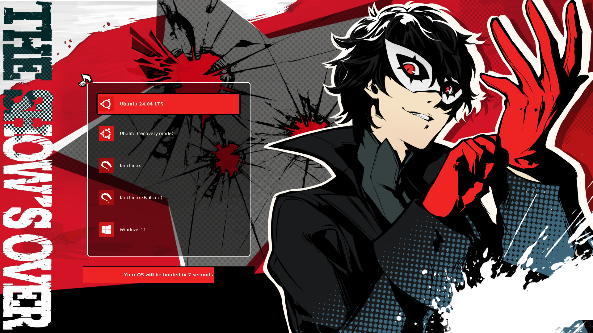
        <br /><strong>Joker</strong>
      </td>
      <td align="center">
        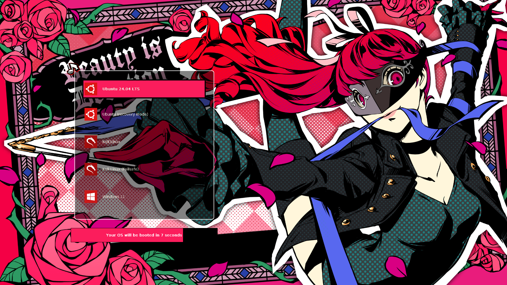
        <br /><strong>Violet</strong>
      </td>
      <td align="center">
        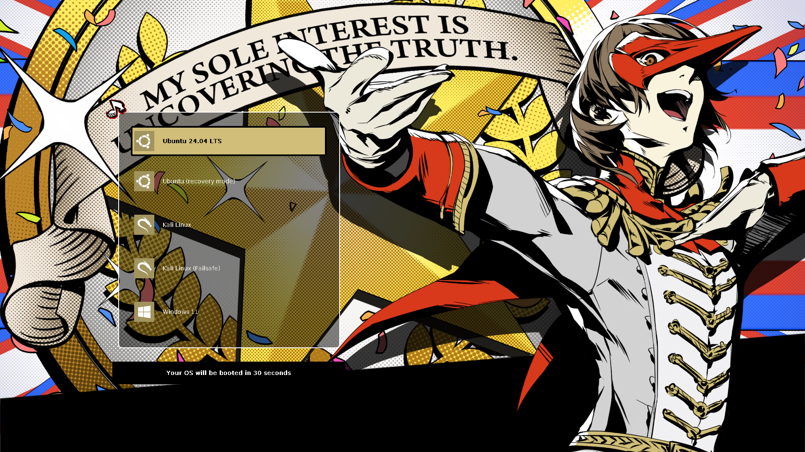
        <br /><strong>Crow</strong>
      </td>
    </tr>
     <tr>
      <td align="center">
        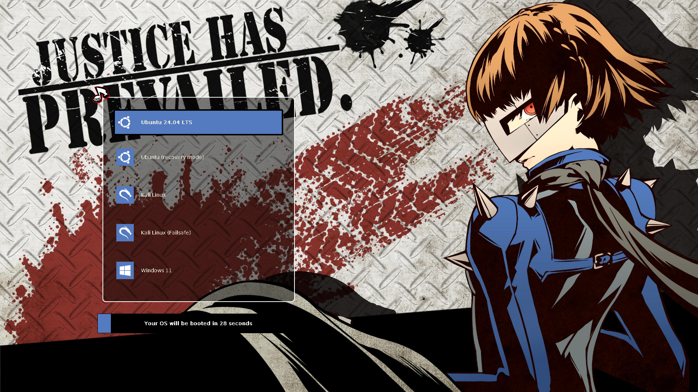
        <br /><strong>Queen</strong>
      </td>
      <td align="center">
        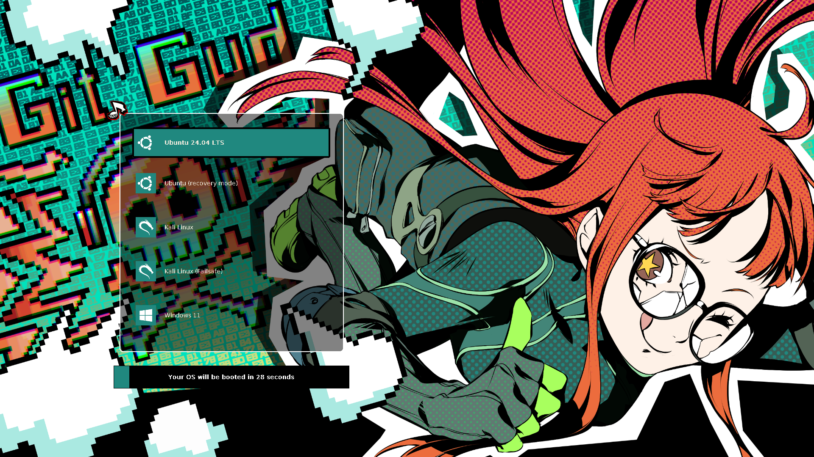
        <br /><strong>Oracle</strong>
      </td>
      <td align="center">
        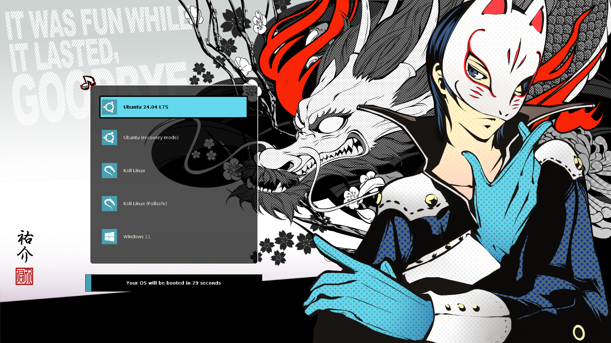
        <br /><strong>Fox</strong>
      </td>
    </tr>
  </table>
</div>

### ✖️ Persona 5: The Phantom X
<div align="center">
  <table>
    <tr>
      <td align="center">
        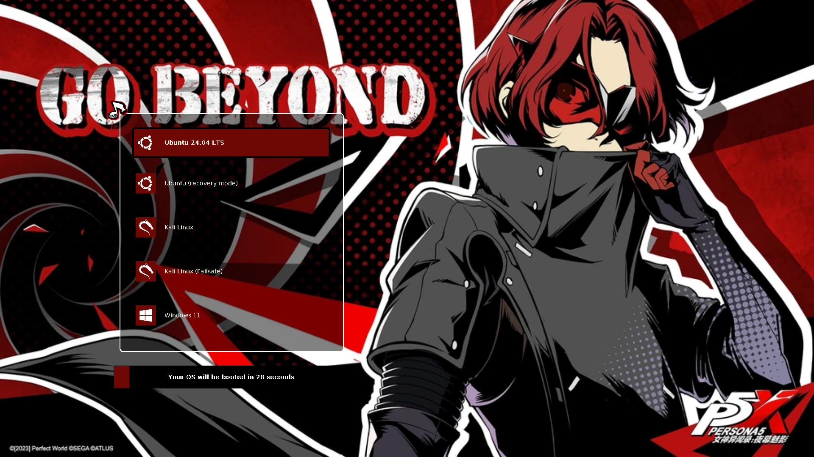
        <br /><strong>Wonder</strong>
      </td>
      <td align="center">
        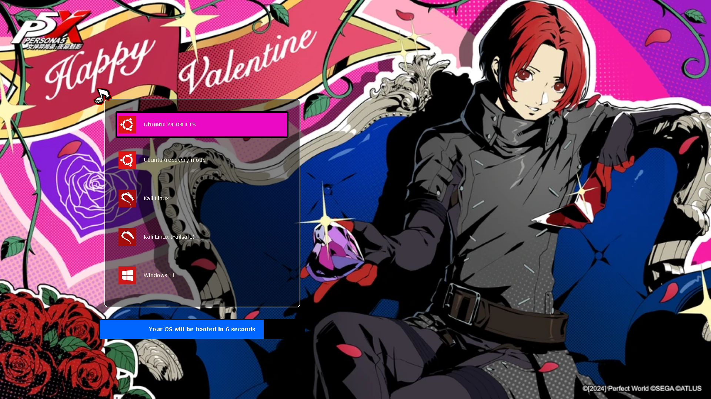
        <br /><strong>Wonder (Valentine)</strong>
      </td>
      <td align="center">
        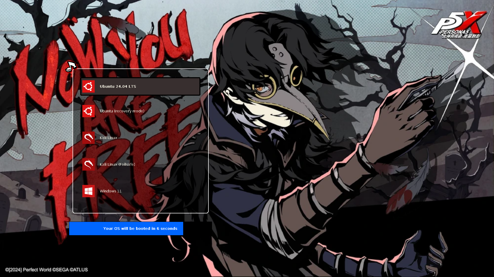
        <br /><strong>Messa</strong>
      </td>
    </tr>
    <tr>
      <td align="center">
        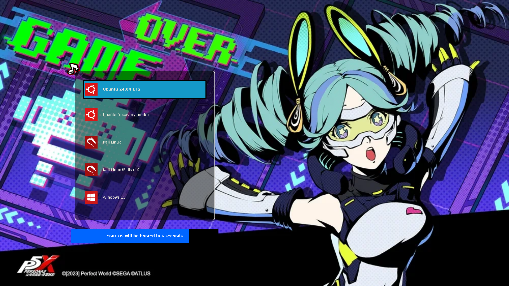
        <br /><strong>Bui</strong>
      </td>
      <td align="center">
        
        <br /><strong>Rin</strong>
      </td>
      <td align="center">
        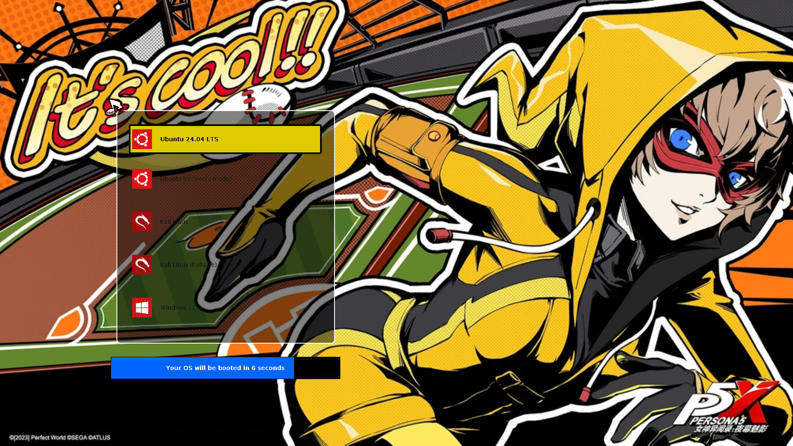
        <br /><strong>Closer</strong>
      </td>
    </tr>
  </table>
</div>

### 🌕 Persona 3 Reload
<div align="center">
  <table>
    <tr>
      <td align="center">
        
        <br /><strong>Makoto</strong>
      </td>
      <td align="center">
        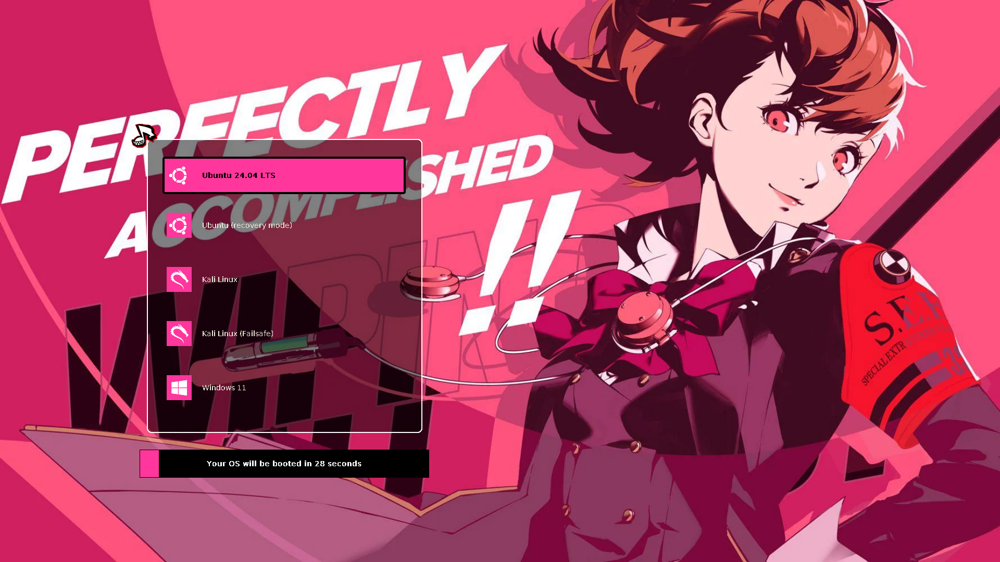
        <br /><strong>Kotone</strong>
      </td>
      <td align="center">
        
        <br /><strong>Aigis (FES)</strong>
      </td>
    </tr>
    <tr>
      <td align="center">
        
        <br /><strong>Shinjiro</strong>
      </td>
      <td align="center">
        
        <br /><strong>Metis</strong>
      </td>
      <td align="center">
        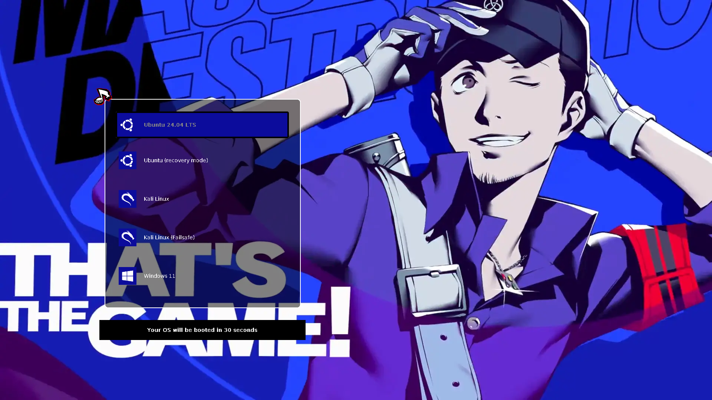
        <br /><strong>Junpei</strong>
      </td>
    </tr>
  </table>
</div>

## ✨ Features

- 🎨 **70+ Character Themes** across three Persona games
- 🎮 **Game Collections:**
  - Persona 5 Royal (13 characters)
  - Persona 5: The Phantom X (42+ characters)
  - Persona 3 Reload (13 characters)
- 🔧 **Easy Installation** with interactive Python script
- 🎨 **Unique Color Scheme** for each character
- 📦 **Multiple Installation Methods** (Script, Manual, or Grub Customizer)
- 🖼️ **High-Quality Assets** from official game sources
- 🔄 **Multiple Variants** for select characters (Beach, CNY, Special editions)
- 🐧 **Cross-Distribution Support** (Ubuntu, Debian, Arch, Fedora, and more)

## 📋 Table of Contents

- [Requirements](#-requirements)
- [Installation](#-installation)
- [Available Themes](#-available-themes)
- [Customization](#-customization)
- [Uninstallation](#-uninstallation)
- [Troubleshooting](#-troubleshooting)
- [Credits](#-credits)
- [License](#-license)
- [Contributing](#-contributing)

## 🔧 Requirements

### System Requirements
- Linux distribution with GRUB2
- Python 3.8 or higher
- Root/sudo access
- At least 50MB free space in `/boot`

### Dependencies
```bash
# Ubuntu/Debian
sudo apt update
sudo apt install python3 python3-pil grub2-common

# Fedora/RHEL
sudo dnf install python3 python3-pillow grub2-tools

# Arch Linux
sudo pacman -S python python-pillow grub

# openSUSE
sudo zypper install python3 python3-Pillow grub2
```

### Optional Tools
```bash
# grub-customizer for GUI theme management
sudo apt install grub-customizer
```

## 🚀 Installation

### Method 1: Interactive Script (Recommended)

1. **Clone the repository**
```bash
   git clone https://github.com/HamzaKarrouchi/Persona_GRUB_Themes.git
   cd Persona_GRUB_Themes
```

2. **Run the installer**
```bash
   sudo python3 install.py
```

3. **Follow the interactive prompts:**
   - Select your game (Persona 3 Reload / Persona 5 Royal / Persona 5: The Phantom X)
   - Choose your character from the list
   - Pick a variant if multiple versions are available
   - Confirm installation

4. **Reboot to see your new theme!**
```bash
   sudo reboot
```

### Method 2: Manual Installation

1. **Choose and copy your theme**
```bash
   # Example: Installing Joker theme
   sudo mkdir -p /boot/grub/themes
   sudo cp -r themes/persona5_royal/joker /boot/grub/themes/
```

2. **Edit GRUB configuration**
```bash
   sudo nano /etc/default/grub
```
   
   Add or modify these lines:
```bash
   GRUB_THEME="/boot/grub/themes/joker/theme.txt"
   GRUB_GFXMODE=1920x1080
   GRUB_GFXPAYLOAD_LINUX=keep
```
   
   Comment out this line if present:
```bash
   #GRUB_TERMINAL_OUTPUT="console"
```

3. **Update GRUB**
```bash
   # Ubuntu/Debian/Mint
   sudo update-grub
   
   # Arch/Manjaro/Fedora
   sudo grub-mkconfig -o /boot/grub/grub.cfg
   
   # RHEL/CentOS (UEFI)
   sudo grub2-mkconfig -o /boot/efi/EFI/redhat/grub.cfg
```

4. **Reboot**
```bash
   sudo reboot
```

### Method 3: Using grub-customizer

1. **Install grub-customizer**
```bash
   sudo apt install grub-customizer  # Ubuntu/Debian
```

2. **Launch with sudo**
```bash
   sudo grub-customizer
```

3. **Navigate to Appearance Settings**
   - Click on `Appearance Settings` tab
   - Select `Theme` section

4. **Add the theme**
   - Click the `+` button
   - Navigate to `themes/persona5_royal/joker` (or your chosen theme)
   - Select the folder

5. **Apply and save**
   - Click `Save`
   - Reboot your system

## 🎨 Available Themes

### Persona 5 Royal (13 themes)
<details>
<summary>Click to expand character list</summary>

- **Joker** (Ren Amamiya) - Leader of the Phantom Thieves
- **Skull** (Ryuji Sakamoto) - The speedster
- **Panther** (Ann Takamaki) - The femme fatale
- **Mona** (Morgana) - The feline mascot
- **Fox** (Yusuke Kitagawa) - The eccentric artist
- **Queen** (Makoto Niijima) - The strategist
- **Oracle** (Futaba Sakura) - The hacker
- **Noir** (Haru Okumura) - The elegant fighter
- **Crow** (Goro Akechi) - The detective prince
- **Black Mask** (Goro Akechi) - Alternative form
- **Violet** (Kasumi Yoshizawa) - The gymnast
- **Caroline & Justine** - Twin wardens
- **Lavenza** - True form of the twins

</details>

### Persona 5: The Phantom X (42+ themes)
<details>
<summary>Click to expand character list</summary>

**Main Characters:**
- Wonder (Multiple variants: Default, Valentine, Beach, CNY)
- Cattle
- Mont
- Closer (Motoha)
- Bui
- Rin
- Messa
- Yuki

**And many more variants including seasonal and special editions!**

</details>

### Persona 3 Reload (13 themes)
<details>
<summary>Click to expand character list</summary>

- **Makoto Yuki** - The protagonist
- **Yukari Takeba** - The archer
- **Junpei Iori** - The comic relief
- **Akihiko Sanada** - The boxer
- **Mitsuru Kirijo** - The leader
- **Fuuka Yamagishi** - The navigator
- **Aigis** - The android
- **Ken Amada** - The youngest member
- **Koromaru** - The loyal dog
- **Shinjiro Aragaki** - The lone wolf
- **Kotone Shiomi** (FeMC) - Female protagonist
- **Metis** - Aigis's sister
- **Aigis (FES)** - The Answer version

</details>

## 🎨 Customization

### Adjusting Screen Resolution

If the theme doesn't fit your screen properly:
```bash
sudo nano /etc/default/grub
```

Modify or add:
```bash
GRUB_GFXMODE=1920x1080  # Change to your resolution
GRUB_GFXPAYLOAD_LINUX=keep
```

Common resolutions:
- `1920x1080` (Full HD)
- `2560x1440` (2K)
- `3840x2160` (4K)
- `1366x768` (Laptop)

### Modifying Theme Elements

Each theme folder contains:
- `theme.txt` - Main configuration file
- `background.png` - Background image
- `select_*.png` - Selection highlight images
- `*.pf2` - Font files
- `icons/` - OS icons (if present)

You can customize any of these files to your liking.

### Creating Your Own Theme

1. Copy an existing theme as a template
2. Replace `background.png` with your image (1920x1080 recommended)
3. Adjust colors in `theme.txt`
4. Modify selection images if needed
5. Test with the installation script

## 🗑️ Uninstallation

### Remove Specific Theme
```bash
sudo rm -rf /boot/grub/themes/[theme-name]
```

### Restore Default GRUB
```bash
# Edit GRUB config
sudo nano /etc/default/grub

# Remove or comment out the GRUB_THEME line:
#GRUB_THEME="/boot/grub/themes/..."

# Update GRUB
sudo update-grub  # Ubuntu/Debian
# OR
sudo grub-mkconfig -o /boot/grub/grub.cfg  # Arch/Fedora

# Reboot
sudo reboot
```

## 🐛 Troubleshooting

### Theme doesn't appear after installation

**Check GRUB configuration:**
```bash
grep GRUB_THEME /etc/default/grub
```

**Verify theme files exist:**
```bash
ls -la /boot/grub/themes/[theme-name]/theme.txt
```

**Regenerate GRUB config:**
```bash
sudo update-grub
```

### Low resolution or wrong aspect ratio

Edit `/etc/default/grub`:
```bash
GRUB_GFXMODE=1920x1080
GRUB_GFXPAYLOAD_LINUX=keep
```

### UEFI Secure Boot issues

Some systems with Secure Boot may not load custom themes. Options:
1. Disable Secure Boot in BIOS/UEFI
2. Sign the GRUB modules (advanced)
3. Use a distribution-provided theme

### Theme shows but images are missing

Ensure all theme files were copied:
```bash
sudo cp -r themes/persona5_royal/joker /boot/grub/themes/
```

### Grub doesn't show at boot

Edit `/etc/default/grub`:
```bash
GRUB_TIMEOUT=10  # Show menu for 10 seconds
#GRUB_HIDDEN_TIMEOUT=0  # Comment out this line
```

## 👏 Credits

### Inspiration & References
This project was heavily inspired by:
- **[StarRailGrubThemes](https://github.com/voidlhf/StarRailGrubThemes)** by voidlhf - Main inspiration for project structure and installation system
- **[Persona5GrubThemes](https://github.com/SiriusLL/Persona5GrubThemes)** by SiriusLL - Original Persona 5 Royal GRUB themes
- **[Starfield Theme](https://github.com/endlessm/grub/tree/master/themes/starfield)** - Reference for GRUB theme structure

### Asset Sources
- **All Out Attack Images**: Extracted from Persona 5 Royal game files
  - [Reddit Post 1](https://www.reddit.com/r/Persona5/comments/fxqgmf/p5r_clean_all_out_attack_finisher_images_ripped/)
  - [Reddit Post 2](https://imgur.com/gallery/1mtkoBr)
- **Persona 5X Assets**: From official game promotional materials
- **Persona 3 Reload Assets**: From official game and promotional materials
- **Distribution Icons**: [Uniform Linux Icon Set](https://www.reddit.com/r/linux/comments/nt1tm9/i_made_a_uniform_icon_set_of_linux_distribution/)
  - Icons color-adjusted to match each game's aesthetic

### Special Thanks
- **ATLUS/SEGA** - For creating the incredible Persona series
- **voidlhf** - For the StarRail GRUB themes that inspired this project
- **SiriusLL** - For the original Persona 5 GRUB themes
- All contributors and the Persona community

## 🤝 Contributing

Contributions are warmly welcomed! Here's how you can help:

### How to Contribute

1. **Fork the repository**
2. **Create a feature branch**
```bash
   git checkout -b feature/AmazingNewTheme
```
3. **Make your changes**
   - Add new themes
   - Fix bugs
   - Improve documentation
4. **Commit your changes**
```bash
   git commit -m 'Add Persona 4 Golden themes'
```
5. **Push to your branch**
```bash
   git push origin feature/AmazingNewTheme
```
6. **Open a Pull Request**

### Contribution Ideas

- 🎨 **Add new character themes** from Persona 4, Persona Q, etc.
- 🐛 **Report bugs** or compatibility issues
- 📖 **Improve documentation** or add translations
- 💡 **Suggest features** or enhancements
- 🎭 **Create theme variants** (seasonal, alternate colors)
- 🔧 **Improve installation script** with new features

### Guidelines

- Follow existing theme structure
- Test themes before submitting
- Provide preview images
- Use high-quality assets
- Respect copyright and give credit

## 🐛 Known Issues

- Some distributions may require additional GRUB configuration tweaks
- Theme may not display on systems with UEFI Secure Boot enabled
- High-resolution displays (4K+) may need manual scaling adjustments
- Older GRUB versions (< 2.0) may have limited theme support

## 📞 Support

Need help? Have questions?

- 🐛 **Bug Reports**: [GitHub Issues](https://github.com/HamzaKarrouchi/Persona_GRUB_Themes/issues)
- 💬 **Discussions**: [GitHub Discussions](https://github.com/HamzaKarrouchi/Persona_GRUB_Themes/discussions)
- 📧 **Email**: [hamza.karrouchi.dev@gmail.com](mailto:hamza.karrouchi.dev@gmail.com)
- ⭐ **Star the repo** if you find it useful!

## ⭐ Show Your Support

If you enjoy this project, please consider:

- ⭐ **Starring the repository** on GitHub
- 🐛 **Reporting bugs** to help improve the project
- 💬 **Sharing with friends** who love Persona
- 🤝 **Contributing** new themes or improvements
- 📢 **Spreading the word** on social media

## 📊 Project Stats


---

<div align="center">

**Made with ❤️ by Persona fans, for Persona fans**

*"I am thou, thou art I... Thou hast acquired a new bootloader theme!"*

[](https://github.com/HamzaKarrouchi)
[](mailto:hamza.karrouchi.dev@gmail.com)

[⬆ Back to top](#-persona-grub-themes-collection)

</div>